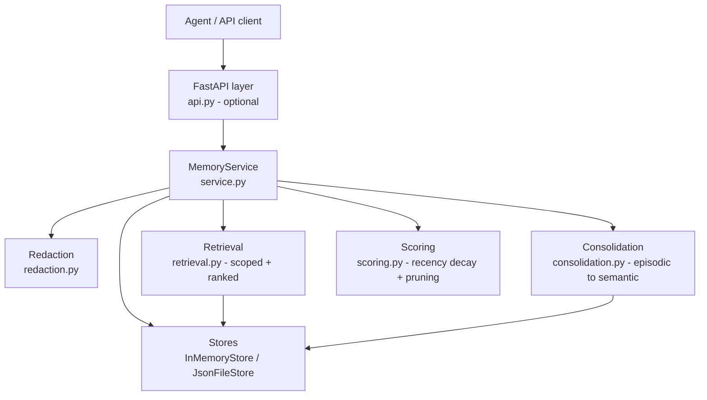

# Architecture

## Diagram (Mermaid)



## ASCII view

```
Client ──► FastAPI (optional) ──► MemoryService ──┬──► Redaction (write time)
                                                 ├──► Stores (memory / JSON)
                                                 ├──► Retrieval (exact scope, ranked)
                                                 ├──► Consolidation (topic groups)
                                                 └──► Scoring / pruning policy
```

## Component notes

- **models.py** — typed dataclasses: `Scope`, `EpisodicRecord`,
  `SemanticFact`, `ProceduralSkill`, `AuditEntry`. No external dependencies.
- **service.py** — the only orchestration layer. Every write goes through
  it, so redaction, supersession and auditing cannot be bypassed by calling
  a store directly in production paths.
- **stores.py** — `InMemoryStore` holds plain dicts; `JsonFileStore`
  serialises the same structures to one JSON file (ISO-8601 datetimes).
  A database-backed store would implement the same `*_for` / delete surface.
- **retrieval.py** — exact-scope filtering first, then ranking. Ranking:
  episodic by combined importance/recency score, facts by confidence, skills
  by success rate. `resolve_active_facts` is a defensive dedup layer.
- **consolidation.py** — pure function over episodic records; grouping key
  is (scope, first tag). Emits facts with full provenance, never deletes
  sources.
- **scoring.py** — exponential recency decay (half-life 30 days); prune
  rule is a conjunction (stale AND low-importance) so pruning cannot delete
  important history on age alone.
- **api.py** — thin FastAPI wrapper. No business logic lives here; it maps
  HTTP payloads onto `MemoryService` calls.

## Data flow: writing a fact that conflicts

1. Client posts a fact for scope S, subject P, predicate Q.
2. Service redacts the object text, then finds the active S/P/Q fact.
3. The old fact gets `superseded_by` = new id and `superseded_at` = now.
4. An audit entry (`superseded`) and one (`created`) are appended.
5. Retrieval for S returns only the new fact; the old one remains queryable
   via `facts_for(..., active_only=False)` for audit.

## Scaling notes (what would change in production)

- Replace `JsonFileStore` with a database + transactional supersession.
- Add embeddings/vector search as a *ranking* signal inside retrieval,
  keeping exact-scope filtering as a hard pre-filter (never post-filter).
- Add a background consolidation job (scheduled, not request-triggered)
  and per-scope retention policies instead of global defaults.
